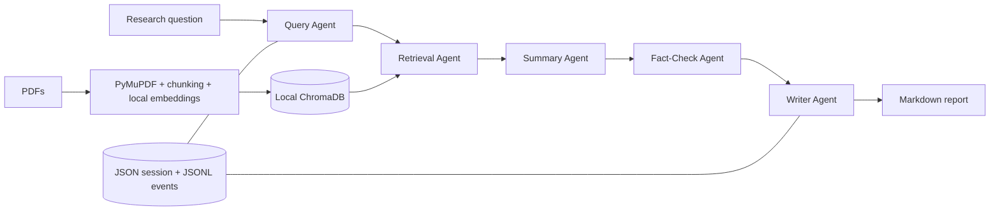

# Academic Research Assistant

A small, local first, five agent literature review pipeline for an academic demonstration. Put searchable academic PDFs in `data/papers/`, ingest them, then ask a question. The report cites retrieved page chunks and records claims removed by the critic.

## Architecture



This pipeline keeps each responsibility visible during a viva. Retrieval grounds the summary; the critic checks each claim before the writer can cite it. The agents are Semantic Kernel `ChatCompletionAgent` instances with their own prompts and Python tool plugins. The engine passes validated Pydantic models between them. ChromaDB stores text, embeddings and source metadata; JSON files keep session memory and events. There is no web search or external embedding API.

| Agent | Job | Python tools |
| --- | --- | --- |
| Query | Split the question into search dimensions | `extract_keywords`, `validate_and_normalize_queries` |
| Retrieval | Search local passages and preserve metadata | `search_vector_store`, `retrieve_document_metadata` |
| Summary | Draft evidence linked findings | `group_passages_by_theme`, `validate_summary_structure` |
| Fact-Check | Verify claims against exact quotes | `extract_claims`, `verify_claim_against_evidence` |
| Writer | Render only checked findings | `validate_final_citations`, `generate_research_report` |

## Setup on Windows PowerShell

Requires Python 3.11+ and Git. Install [Ollama](https://ollama.com/download), start it, then run `ollama pull qwen3:4b`. From this project root:

```powershell
python -m venv .venv
.\.venv\Scripts\Activate.ps1
python -m pip install -r requirements.txt
Copy-Item .env.example .env
python cli.py
```

The CLI offers status, ingestion, indexed papers, new research, and saved sessions. Put one or more text based PDFs in `data/papers/` before choosing **Ingest research papers**. Re-indexing clears and rebuilds the local collection. Reports and JSON sessions go to `data/sessions/`; append only events go to `data/logs/`. These generated files, `.env`, and `.venv/` are ignored by Git.

`LLM_PROVIDER=ollama` is the default and uses `OLLAMA_BASE_URL` and `OLLAMA_MODEL`. The startup check verifies server, model and a live JSON response. The local Semantic Kernel adapter calls Ollama's raw endpoint because this installed Qwen3 template otherwise spends its response budget on a thinking preamble. If Ollama fails, research stops with an error. To use OpenRouter, set `LLM_PROVIDER=openrouter`, `OPENROUTER_API_KEY`, and `OPENROUTER_MODEL` in `.env`; there is no automatic fallback. Both providers use the same Semantic Kernel agent interface. Sentence Transformers computes all embeddings on this machine. The first use of the configured embedding model may download its weights; later inference is local.

Tune `CHUNK_SIZE`, `CHUNK_OVERLAP`, and `RETRIEVAL_TOP_K` in `.env`. Every retrieved passage retains document ID, title, filename, page, chunk ID, text and relevance score.

## Tests and notebook

```powershell
.\.venv\Scripts\python.exe -m pytest -q -m "not integration"
.\.venv\Scripts\python.exe -m pytest -q -m integration
.\.venv\Scripts\python.exe -m ipykernel install --user --name academic-research-assistant --display-name "Academic Research Assistant (.venv)"
```

Choose that kernel in `notebooks/demo.ipynb` and edit its example question to fit your PDFs. The deterministic tests mock model responses; the integration test needs a responding provider and creates a temporary synthetic PDF. It does not represent a real academic finding.

**Honest failure:** A scanned PDF without extractable text is reported during ingestion and skipped. If retrieval finds no useful passages, the report says evidence is insufficient. Claims without exact supporting passage quotes are removed and listed in **Unsupported Claims Removed**. Quote matching is a conservative check, not proof of scientific truth; a human should review final claims and the original papers.
